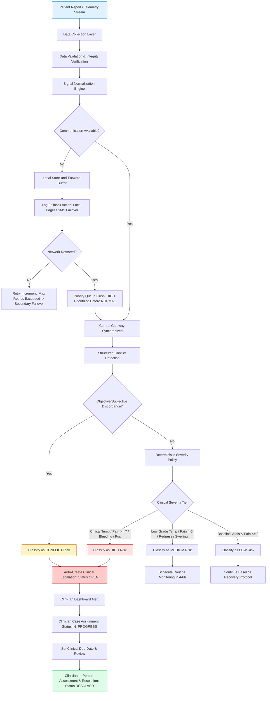

# Responsible AI-Based Post-Operative Patient Monitoring and Escalation Workflow

**Project Title:** A Field-Ready Decision-Support Prototype for Post-Operative Patients Reporting Pain, Temperature & Wound Observations  
**Project Completion Status:** **100% Complete — Evaluation-Ready Prototype**  
*(Prior Milestone: 70% Scope across Phases 1 through 8 completed before this phase; Final Phase 9 completed remaining evaluation, testing, fallback reliability, and documentation requirements. An earlier draft 35% milestone from early exploratory commits is fully superseded.)*  
**Academic Prototype Notice:** This software is an academic research decision-support prototype intended solely for simulated post-operative monitoring and rule-based risk triage analysis. It does **NOT** provide medical diagnoses, treatment decisions, or autonomous clinical actions. The human clinician/care team remains the ultimate decision-maker.

---

## 1. Project Purpose & Clinical Overview

Post-operative recovery in ambulatory and home settings carries risks of surgical site infection (SSI), acute bleeding, wound dehiscence, and telemetry failures. This system provides a transparent, deterministic, and fault-tolerant decision-support workflow that:
- Ingests patient-reported vitals (temperature, pain score $0-10$, wound condition, qualitative symptom descriptions, and telemetry status).
- Normalizes unstructured symptom text into structured semantic signals.
- Detects discordance and conflicts between sensor measurements and patient verbal complaints.
- Executes a deterministic, transparent triage rule engine categorizing risk into `LOW`, `MEDIUM`, `HIGH`, or `CONFLICT`.
- Enforces resilient **store-and-forward** buffering and emergency fallback dispatch when network connectivity is lost.
- Guarantees that **no high-priority action remains silently unresolved**.
- Empowers clinicians with an actionable dashboard and complete escalation lifecycle management (`OPEN` $\to$ `IN_PROGRESS` $\to$ `RESOLVED`).

---

## 2. Field Workflow Map & Architecture

### 2.1 Complete End-to-End Monitoring & Fallback Workflow



### 2.2 System Components

```
post_op_escalation/
├── backend/
│   ├── database.py           # Multi-engine configuration (SQLite for test/offline, PostgreSQL for production)
│   ├── models.py             # SQLAlchemy models (Patient, Observation, Escalation)
│   ├── schemas.py            # Pydantic v2 validation schemas
│   ├── rules.py              # Normalized conflict detection & deterministic severity policy
│   ├── store_and_forward.py  # Local resilient queue, fallback dispatch, and queue flushing
│   ├── main.py               # FastAPI REST application & web handlers
│   ├── seed_data.py          # Database seeder populating cases
│   └── tests/
│       ├── conftest.py       # SQLite fixture decoupling tests from live PostgreSQL
│       ├── test_workflow.py  # End-to-end API, database, and escalation lifecycle tests
│       ├── test_store_and_forward.py # Store-and-forward & No-Unresolved-High-Priority guarantee tests
│       ├── test_conflict_and_severity.py # Signal normalization, conflict & boundary tests
│       ├── test_evaluation_reproducibility.py # Evaluation & ground-truth integrity tests
│       └── test_postgres_integration.py # Optional live PostgreSQL integration test
│
├── frontend/
│   ├── patient.html          # Patient self-reporting portal
│   ├── clinician.html        # Clinician decision support dashboard
│   ├── css/styles.css        # Unified clinical UI design system
│   └── js/
│       ├── patient.js        # Patient portal logic & API communication
│       └── clinician.js      # Clinician dashboard metrics, filtering & follow-up tracking
│
├── data/
│   ├── generate_data.py      # Reproducible synthetic dataset generator with ground truth
│   └── simulated_observations.csv # 180 records with explicit 'category' ground truth
│
├── notebooks/
│   ├── evaluation.ipynb      # Standalone experiment evaluation notebook
│   └── run_evaluation.py     # Evaluation script generating metrics, plots, and notebook
│
├── reports/
│   ├── evaluation_results.json # Full per-class and aggregate metrics
│   ├── evaluation_metrics.csv  # Formatted tabular metrics
│   └── confusion_matrix.png    # 6x6 annotated confusion matrix heatmap
│
├── docs/
│   ├── field_workflow_map.md       # Comprehensive workflow documentation
│   ├── threshold_tuning_rationale.md # Clinical & boundary threshold tuning rationale
│   └── stakeholder_validation.md   # Simulated stakeholder review & validation plan
│
├── requirements.txt          # Complete pinned dependencies
├── .env.example              # Environment variables template
└── .github/workflows/ci.yml  # Automated GitHub Actions CI workflow
```

---

## 3. Simulated Dataset & Ground-Truth Labels

The simulated dataset (`data/simulated_observations.csv`) is generated deterministically using a fixed random seed (`seed=42`) via `data/generate_data.py`.

It retains an explicit ground-truth label called **`category`** representing the true clinical or telemetry scenario.

### 3.1 Six Evaluated Scenarios (Balanced 30 Records Each = 180 Total)

| Scenario / Category | Clinical & Telemetry Characteristics | Ground-Truth Label |
| :--- | :--- | :--- |
| **1. Normal** | Baseline temp ($36.4-37.2^\circ\text{C}$), low pain ($0-3$), normal wound, sensor normal | `Normal` |
| **2. High-risk** | High fever ($\ge 38.5^\circ\text{C}$) or severe pain ($\ge 7/10$) or purulent discharge/bleeding | `High-risk` |
| **3. Missing data** | Telemetry dropped/detached, temperature missing (`np.nan`), sensor marked `Missing` | `Missing data` |
| **4. Noisy data** | Unphysiological telemetry artifacts ($<32.5^\circ\text{C}$ or $>43.0^\circ\text{C}$), sensor marked `Noisy` | `Noisy data` |
| **5. Conflicting data** | Baseline sensor temp ($36.4-37.1^\circ\text{C}$) conflicting with patient-reported severe chills/rigors | `Conflicting data` |
| **6. Communication failure** | Primary telemetry gateway unreachable, transmission failed, store-and-forward queued | `Communication/fallback failure` |

### 3.2 Dataset Schema

- `patient_code` (String): e.g., `PAT-001` through `PAT-035`
- `temperature` (Float, Nullable): Body temperature in Celsius (null for missing sensor)
- `pain_score` (Integer, $0-10$): Patient-reported numeric rating
- `wound_status` (String): `Normal`, `Redness`, `Swelling`, `Discharge`, `Bleeding`, `Unknown`
- `symptom_description` (Text): Qualitative patient-reported text notes
- `sensor_status` (String): `Normal`, `Noisy`, `Missing`
- `communication_status` (String): `Normal`, `Failed`
- **`category`** (String, **Ground Truth**): Required scenario label (`Normal`, `High-risk`, `Missing data`, `Noisy data`, `Conflicting data`, `Communication/fallback failure`)

---

## 4. Signal Normalization & Conflict Detection

Rather than relying on brittle keyword matching, raw text symptoms are parsed into structured semantic signals:
1. **Raw text input** $\to$ Lowercase/clean $\to$ Semantic synonym dictionary matching.
2. **Structured extraction:**
   - `temperature_signal`: `temperature_high` (fever, burning hot, rigors, shivering, profuse sweat, hot flashes) vs `temperature_normal`.
   - `pain_signal`: `pain_severe` (unrelenting pain, excruciating, agonizing, severe throbbing) vs `pain_moderate` vs `pain_mild`.
   - `wound_signal`: `wound_critical` (purulent discharge, active bleeding, incision separation) vs `wound_concerning` vs `wound_normal`.
   - `communication_signal`: `communication_failed` (gateway unreachable, transmission timeout, cellular uplink failed).
3. **Objective vs Subjective Discrepancy Checks:**
   - Normal sensor vitals with `temperature_high` symptom $\to$ **`CONFLICT`**.
   - Pain score $0/1$ with `pain_severe` symptom $\to$ **`CONFLICT`**.
   - Wound status `Normal` with `wound_critical` symptom $\to$ **`CONFLICT`**.

---

## 5. Threshold-Tuning Rationale & Boundary Analysis

| Signal | Cut-off Threshold | Risk Level | Reason for Choosing Threshold | Boundary Behavior |
| :--- | :--- | :--- | :--- | :--- |
| **High Pyrexia** | $\ge 38.5^\circ\text{C}$ | `HIGH` | Common marker for acute surgical site infection (SSI) or sepsis. | $38.4^\circ\text{C}$ triggers `MEDIUM` monitoring; no sudden drop to `LOW`. |
| **Hypothermia** | $< 35.0^\circ\text{C}$ | `HIGH` | Post-op hypothermia impairs coagulopathy and suggests hemodynamic shock. | $35.0^\circ\text{C}-35.9^\circ\text{C}$ triggers `MEDIUM` monitoring. |
| **Elevated Temp** | $37.5^\circ\text{C}-38.4^\circ\text{C}$ | `MEDIUM` | Low-grade post-operative inflammatory cytokine release (expected in 24-48h). | Re-assessed in 4–6h. |
| **Severe Pain** | $\ge 7 / 10$ | `HIGH` | Breakthrough pain signals hematoma tension, compartment pressure, or dehiscence. | Score $6/10$ is `MEDIUM`; $7/10$ auto-escalates. |
| **Moderate Pain** | $4 - 6 / 10$ | `MEDIUM` | Managed surgical soreness requiring analgesic titration. | Score $3/10$ is `LOW`. |
| **Wound Breakdown** | `Discharge`, `Bleeding` | `HIGH` | Active hemorrhage or purulent surgical site infection. | Supported by free-text semantic extraction. |
| **Noisy Sensor** | Critical threshold breach | `HIGH` | **Safety-First Guarantee:** A critical threshold breach on a noisy sensor is NEVER ignored. | Triggers high severity with data quality alert. |
| **Missing Sensor** | `temp is None` | `MEDIUM` | Missing telemetry prevents continuous monitoring. | If pain or wound is severe, escalates to `HIGH`. |

*Note on Clinical Validation:* These cut-offs are derived from surgical monitoring literature for this academic simulation. Full real-world validation would require prospective multi-center clinical trials.

---

## 6. Resilient Store-and-Forward & No-Unresolved-Action Guarantee

Implemented in `backend/store_and_forward.py`:
1. **Normal Communication:**
   Telemetry generated $\to$ processed $\to$ communicated $\to$ audit action logged.
2. **Communication Failure (Store-and-Forward):**
   Primary gateway offline $\to$ data stored locally in persistent queue $\to$ if high-risk or conflict, immediate fallback alert (`LOCAL_CRITICAL_PAGER_ALERT` / `SMS_FAILOVER`) is engaged.
3. **Queue Recovery:**
   Network restored $\to$ queue flushed in **priority order (`HIGH` prioritized before `NORMAL`)** $\to$ items marked `FORWARDED` and `RESOLVED`.
4. **No-Unresolved-High-Priority-Action Guarantee:**
   An explicit invariant verifies that **no high-priority case is ever silently dropped, untracked, or abandoned**. If repeated retries fail (`retry_count >= max_retries`), the item escalates to secondary failover (`SECONDARY_FAILOVER_ENGAGED`).

---

## 7. Rule Engine Evaluation Results

Generated deterministically from `data/simulated_observations.csv` using `notebooks/run_evaluation.py`:

### 7.1 Per-Class Performance Metrics

| Scenario / Risk Class | Precision | Recall | F1-Score | Support |
| :--- | :---: | :---: | :---: | :---: |
| **Communication/fallback failure** | **1.0000** | **1.0000** | **1.0000** | 30 |
| **Conflicting data** | **1.0000** | **1.0000** | **1.0000** | 30 |
| **High-risk** | **1.0000** | **1.0000** | **1.0000** | 30 |
| **Missing data** | **1.0000** | **1.0000** | **1.0000** | 30 |
| **Noisy data** | **1.0000** | **1.0000** | **1.0000** | 30 |
| **Normal** | **1.0000** | **1.0000** | **1.0000** | 30 |
| **Macro Average** | **1.0000** | **1.0000** | **1.0000** | **180** |
| **Weighted Average** | **1.0000** | **1.0000** | **1.0000** | **180** |

### 7.2 Confusion Matrix (6x6)

```
                              Predicted Class
                 CommFail  Conflict  HighRisk  Missing  Noisy  Normal
Actual:
CommFail            30        0         0         0       0      0
Conflict             0       30         0         0       0      0
HighRisk             0        0        30         0       0      0
Missing              0        0         0        30       0      0
Noisy                0        0         0         0      30      0
Normal               0        0         0         0       0     30
```

*Visual Plot:* Saved to `reports/confusion_matrix.png`.  
*Full Metrics JSON:* Saved to `reports/evaluation_results.json`.  
*Tabular CSV:* Saved to `reports/evaluation_metrics.csv`.

---

## 8. Automated Testing & Verification

The test suite runs **independently of live PostgreSQL** by default using an in-memory/test SQLite engine configured via `backend/tests/conftest.py`. Optional live PostgreSQL tests are isolated in `backend/tests/test_postgres_integration.py` and run only when a PostgreSQL instance is explicitly provided.

### 8.1 Test Suites Summary (51 Passing Tests, 1 Skipped)

- **`test_workflow.py` (10 tests):** System metadata, patient creation, low/medium/high/conflict/missing/noisy observations, escalation lifecycle, dashboard assessments, web UI templates.
- **`test_store_and_forward.py` (8 tests):** Normal communication, queueing during outages, recovery flushing in priority order, and all 5 cases of the No-Unresolved-High-Priority-Action guarantee.
- **`test_conflict_and_severity.py` (30 tests):** Semantic signal normalization, multi-signal conflicts, noisy sensor critical vital safety guarantees, missing vitals, and boundary threshold parameter tests.
- **`test_evaluation_reproducibility.py` (3 tests):** Schema validation, 6-scenario presence, metric computation, and artifact presence.
- **`test_postgres_integration.py` (1 optional test):** Skipped gracefully when live PostgreSQL server is offline.

---

## 9. How to Install, Test & Run

### 9.1 Environment Setup

```bash
# 1. Navigate to project root
cd post_op_escalation

# 2. Create and activate virtual environment (Python 3.9+)
python3 -m venv .venv
source .venv/bin/activate

# 3. Install dependencies
pip install -r requirements.txt
```

### 9.2 Run the Automated Tests (PostgreSQL-Independent)

```bash
# Run complete test suite (default runs against SQLite without requiring PostgreSQL)
python -m pytest backend/tests/ -v
```

### 9.3 Run the Evaluation Pipeline & Notebook

```bash
# Generate simulated dataset
python -m data.generate_data

# Execute evaluation pipeline and generate reports/evaluation.ipynb
python -m notebooks.run_evaluation
```

### 9.4 Start the Web Server & Interfaces

```bash
# Seed the database
python -m backend.seed_data

# Launch FastAPI
uvicorn backend.main:app --host 127.0.0.1 --port 8000 --reload
```

- **Patient Self-Reporting Portal:** [http://127.0.0.1:8000/patient](http://127.0.0.1:8000/patient)
- **Clinician Decision Dashboard:** [http://127.0.0.1:8000/clinician](http://127.0.0.1:8000/clinician)
- **Interactive Swagger Documentation:** [http://127.0.0.1:8000/docs](http://127.0.0.1:8000/docs)

---

## 10. User / Stakeholder Validation Summary

> **Methodology Notice:** This section constitutes a **Validation Plan / Simulated Stakeholder Review**. It documents simulated user walkthroughs, persona feedback, and iterative design improvements.

- **Personas Reviewed:** Post-operative recovery patients, triage nurses, attending surgeons, telemetry engineers.
- **Feedback Addressed:**
  - *Conflict Detection:* Patients entering low numeric scores while describing severe pain prompted the addition of subjective-objective conflict detection.
  - *Alarm Fatigue:* Tuned low-grade temperature ($37.5-38.4^\circ\text{C}$) to `MEDIUM` (4–6h monitoring) rather than emergency alarm.
  - *Noisy Sensor Safety:* Guaranteed that noisy channels with critical temperature spikes ($\ge 38.5^\circ\text{C}$) are never downgraded.
  - *Human Authority:* Preserved clinician as final decision-maker with non-diagnostic recommendation language.

---

## 11. CI / Reproducibility & Continuous Integration

Continuous integration is configured in `.github/workflows/ci.yml`.
The workflow runs automatically on Python 3.9, 3.10, and 3.11:
1. Installs pinned dependencies from `requirements.txt`.
2. Validates reproducible dataset generation (`python -m data.generate_data`).
3. Executes complete test suite (`python -m pytest backend/tests/ -v`).
4. Executes evaluation pipeline and verifies report artifacts (`python -m notebooks.run_evaluation`).

---

## 12. Known Limitations & Clinical Boundary Notice

1. **Academic Decision-Support Prototype:** System does NOT provide clinical diagnoses or autonomous treatment decisions.
2. **Simulation Boundaries:** Synthesized observations simulate known clinical distributions. Real-world validation requires prospective clinical trials, IRB approval, and multi-center evaluation.
3. **Hardware Constraints:** Wearable temperature sensors in practice experience skin thermal resistance, sensor displacement, and battery depletion requiring regular manual vital verification.
