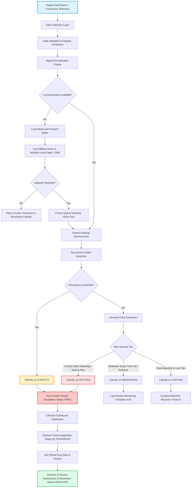

# Field Workflow Map: Post-Operative Monitoring & Escalation

This document maps the complete end-to-end post-operative monitoring process, data validation pipeline, deterministic risk assessment engine, escalation tracking, and resilient store-and-forward fallback mechanisms.

---

## 1. Primary Clinical & Telemetry Monitoring Workflow

---

## 2. Step-by-Step Workflow Stages

1. **Patient Report & Data Collection:**
   - **Inputs:** Body temperature ($^\circ\text{C}$), numeric pain rating ($0-10$), wound visual status (`Normal`, `Redness`, `Swelling`, `Discharge`, `Bleeding`, `Unknown`), qualitative symptom notes, and sensor telemetry status (`Normal`, `Noisy`, `Missing`).
   - Collected via web client (`/patient`) or IoT sensor gateway.

2. **Data Validation:**
   - Format checks, ranges, null/NaN checking for disconnected sensor patches, and out-of-bounds telemetry spike detection.

3. **Signal Normalization:**
   - Raw free-text notes are converted into structured semantic signals:
     - `temperature_signal`: `temperature_high`, `temperature_normal`
     - `pain_signal`: `pain_severe`, `pain_moderate`, `pain_mild`
     - `wound_signal`: `wound_critical`, `wound_concerning`, `wound_normal`
     - `communication_signal`: `communication_failed`

4. **Resilient Store-and-Forward Handling (Fallback Behavior):**
   - If transmission channel drops offline:
     - Data is buffered locally in persistent FIFO queue.
     - If patient vitals reflect high-risk or conflict, an immediate local emergency fallback alert (`LOCAL_CRITICAL_PAGER_ALERT` / `SMS_FAILOVER`) is triggered.
     - **No-Unresolved-High-Priority-Action Guarantee:** No high-risk record can be silently abandoned or untracked.
     - When connectivity is restored, queued telemetry is forwarded in strict priority order (`HIGH` prioritized before `NORMAL`).

5. **Conflict Detection:**
   - Evaluates discordance between sensor readings and patient reports:
     - Normal sensor temperature ($36.0 - 37.4^\circ\text{C}$) while patient reports rigors/chills/fever.
     - Pain score reported as $0/1$ while qualitative text describes severe unrelenting pain.
     - Wound entered as `Normal` while notes indicate purulent discharge or active bleeding.
   - Identified discordance triggers `CONFLICT` status.

6. **Deterministic Risk Classification:**
   - Pure rule-based policy evaluating clinical severity tiers: `LOW`, `MEDIUM`, `HIGH`, `CONFLICT`.
   - **Safety Guarantee:** Noisy sensor status cannot bypass critical vital alert thresholds.

7. **Escalation Decision & Human-in-the-Loop Oversight:**
   - Observations classified as `HIGH` or `CONFLICT` automatically generate an `Escalation` record with status `OPEN`.
   - **Clinician Remains Final Authority:** Prototype provides transparent decision support and explanations; it does NOT initiate autonomous medical treatments or render diagnostic conclusions.
   - Clinician assigns responsibility (`IN_PROGRESS`), sets follow-up deadlines, and marks complete (`RESOLVED`) after verified physical examination.
